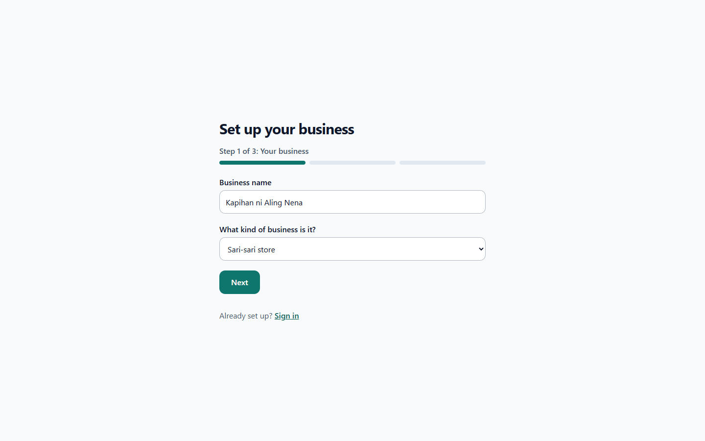
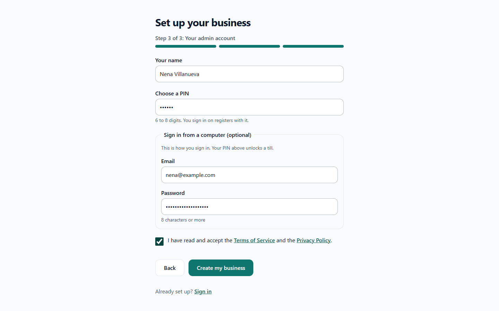
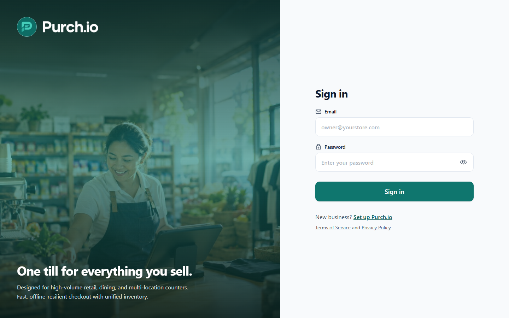
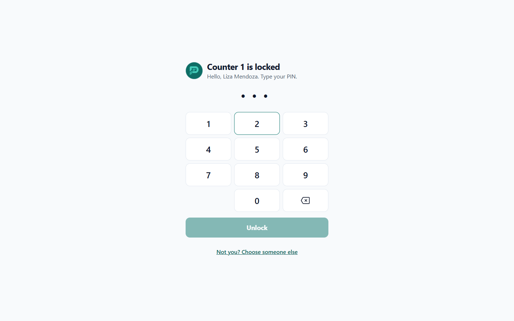
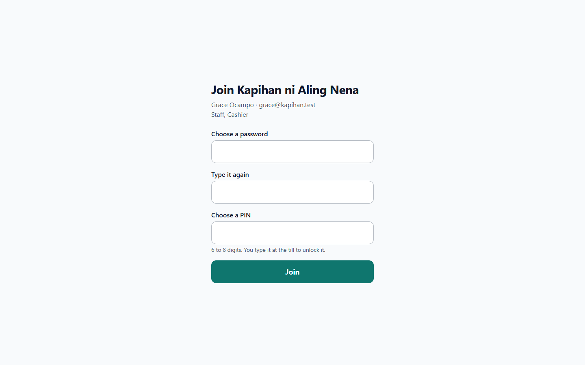
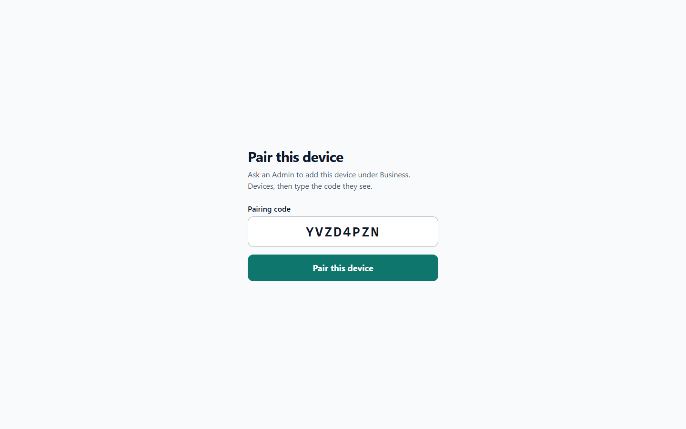

# 1. Getting started

## Create your business

Open the app and choose to set up a new business. The setup has three steps with a progress bar.

1. **Your business.** Enter the **Business name** and choose what kind of business it is: Convenience store, Restaurant, Cafe, Clothing shop, Department store, Grocery store, Sari-sari store, Service business or Other. Some selling modes depend on it (for example, weight and tingi pricing are offered to Sari-sari stores).
2. **Your first branch.** Enter the **Branch name**. You can add more branches later.
3. **Your admin account.** Enter your name and choose a **PIN** of 6 to 8 digits. You will use it at registers. To also sign in from a computer, fill in **Email** and **Password** (at least 8 characters). Agree to the terms and finish.

Whoever completes this step becomes the first **Admin**.

## Sign in

**On a computer or phone:** choose **Sign in**, enter your email and password. Use the eye icon to show what you typed. If your email belongs to more than one business, you are asked "Which business?"; pick one.

**At a shared register:** the register is paired to your branch once (see below). It then shows "<register name> is locked" and "Choose your name." Tap your name, then type your PIN.

- Wrong PIN several times locks only that person for a while. Choose "Not you? Choose someone else" to let a colleague in.
- If the list is empty, an Admin must add you under **Business**, then **Staff**.
- Use **Lock** in the top bar to hand the register to the next person, and **Sign out** when you finish on a personal device.

## Invite staff

Staff do not get emails. An Admin creates an invite link and shares it by chat or in person (see [Staff](06-business-setup.md#staff)). The person opens the link and sees "Join <business>". They:

1. Choose a password (at least 8 characters) and confirm it.
2. Choose a 6 to 8 digit PIN.

The same screen is used to choose a new password when someone is locked out; an Admin issues a fresh link.

## Pair a device

Tills, kiosks, kitchen screens, order boards and customer displays are paired once with a one-time code.

1. An Admin opens **Business**, then **Devices**, and adds the device (name, type, branch). The screen shows "Enter this code on the device".
2. On the device, open the app and go to **Pair this device**. Type the code.

The code works once and expires. If it expires, ask the Admin for a new pairing code.

## Moving around

The left rail (or the menu on a phone) shows the tabs your role allows: **Home**, **Cashier**, **Inventory**, **Reports**, **Business**. Cashiers open straight to the register. Warehouse staff open to Inventory. A banner appears when the device is offline (see [Offline](07-devices-and-hardware.md#when-the-internet-drops)).
