# 2. Selling at the register

Open the **Cashier** tab. Admins and Managers pick a register; Cashiers must be signed in on a paired register ("Sign in with a device to sell"). Selling needs an internet connection and an open shift.

## Start your shift

Open **More** (top right of the register), then **Manage till**. It shows "Shift and cash drawer".

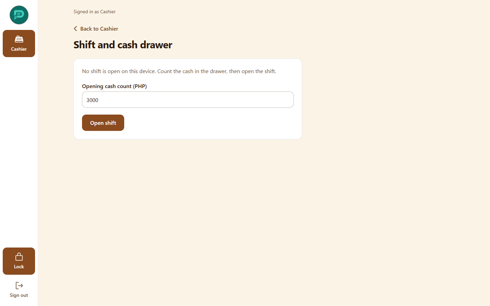

1. Choose **Open shift**.
2. Enter the **Opening cash count** (the peso float in the drawer).

The shift screen shows who opened it, when, and the opening cash. Sales totals for the shift come from the X-reading in Reports.

## Build the cart

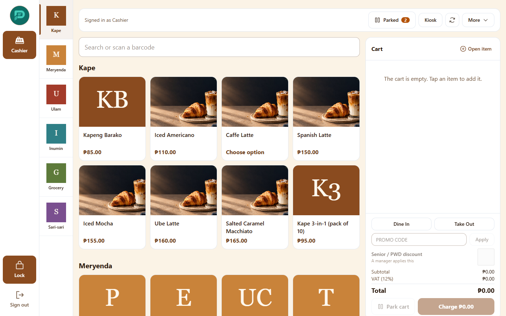

- **Search or scan** a barcode, or tap a category and then an item. Items show **Low stock** or **Out of stock** badges.
- Items with choices open an **Options** dialog: pick the variant and the required or optional add-ons (modifiers).

  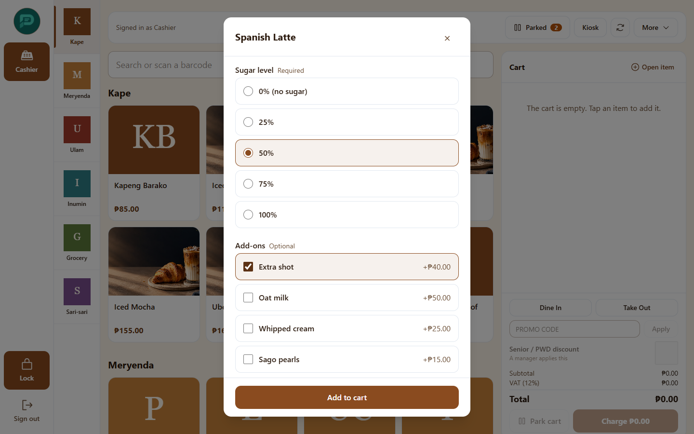

- Items sold by weight open **Weight or amount**. With a connected scale the weight fills in for you.
- Choose **Dine In** or **Take Out** as the order type.
- Tap a line to change quantity. The line menu has **Add note** / **Edit note**, **Discount**, **Change discount** and **Override price**. **Clear cart** empties it.

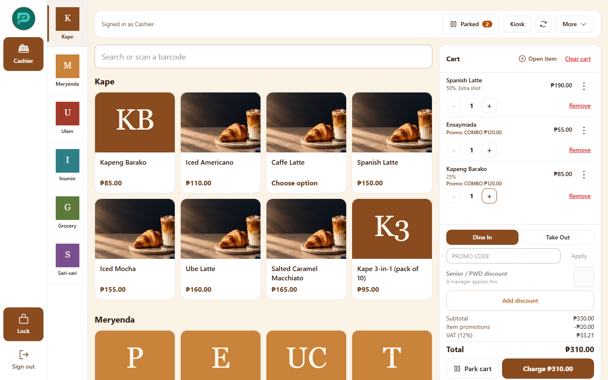

The totals show Subtotal, Item promotions, Item discounts, Senior/PWD (20%) and VAT exemption (12%) when they apply, VAT (12%) and Total. Promotions apply by themselves.

### Promo codes

Type the code in the promo field. An invalid or expired code is refused with a message.

### Open item (something not in the catalog)

Choose **Open item** in the cart header, enter **Name**, **Price**, **Quantity** and an optional **Note**. This only appears if an Admin turned on "Allow open items" in business settings. Open items have no cost, so they are left out of margin reports.

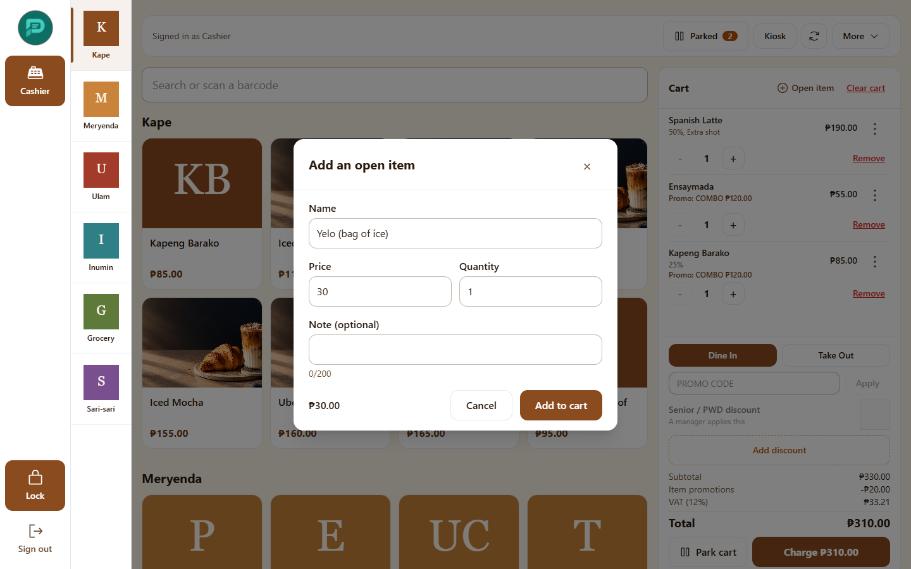

### Discounts and price changes need a manager

A **manual discount** (**Percent off** or **Amount off**, with a reason) and **Override price** need approval every time, even for Managers. A dialog asks for a Manager or Admin PIN. Another person can type theirs at your register without signing you out.

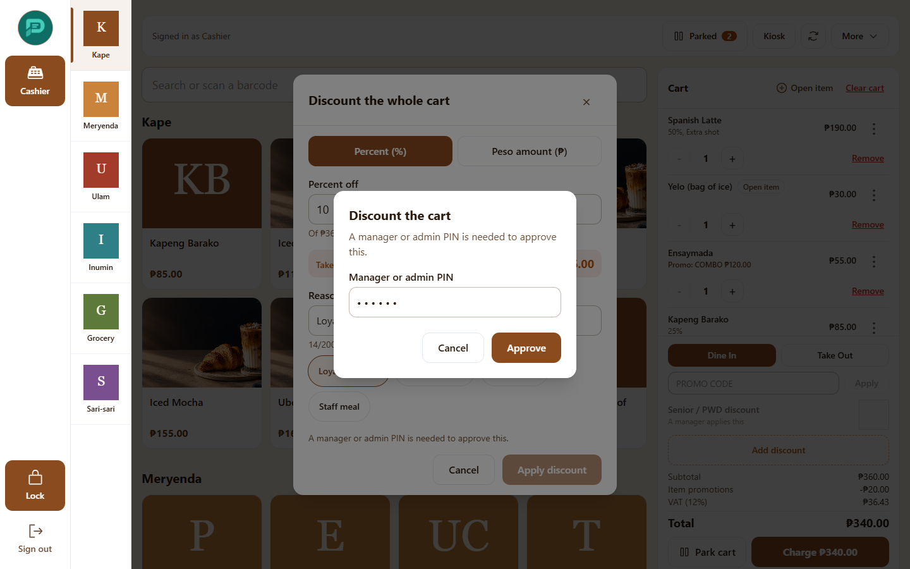

A manual discount cannot be combined with Senior/PWD or promotions.

**Senior Citizen / PWD discount:** the button says "A manager applies this". It takes 20% off the VAT-exclusive price and removes VAT, as BIR rules require. You will be asked for the customer's name and ID number, which print on the receipt.

## Park a cart and come back

Customer forgot their wallet? Choose **Park cart** under the cart. You can add a short label such as "Table 4" or the customer's name. The **Parked** button (with a count) in the top bar opens the parked carts drawer ("Any register in this branch can resume these"). Resuming a cart parks the one you were working on. Parked carts expire after the number of hours an Admin set under business settings. Discarding a parked cart needs a Manager or Admin PIN.

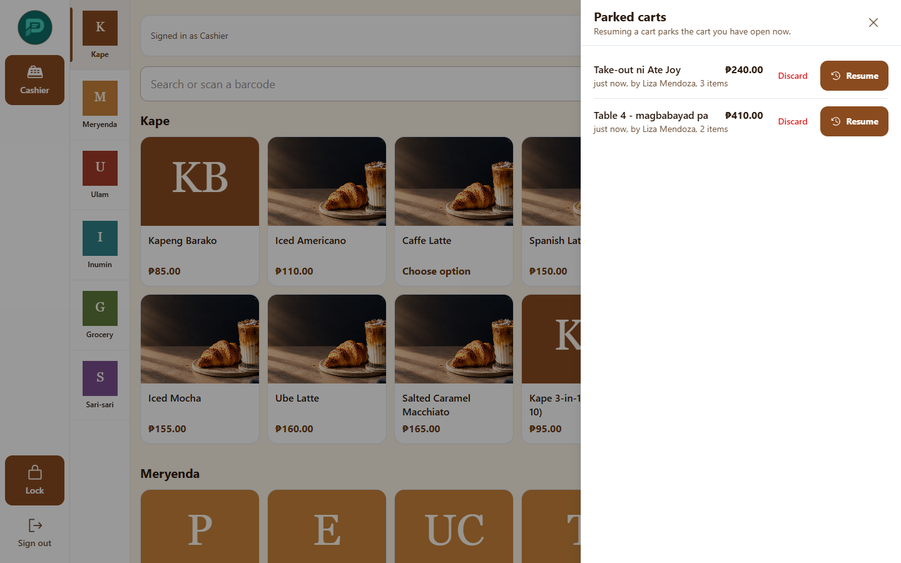

If prices or stock changed while the cart was parked, the totals are recalculated and the changes are listed.

## Take payment

Choose the **Charge** button at the bottom of the cart to open the payment screen.

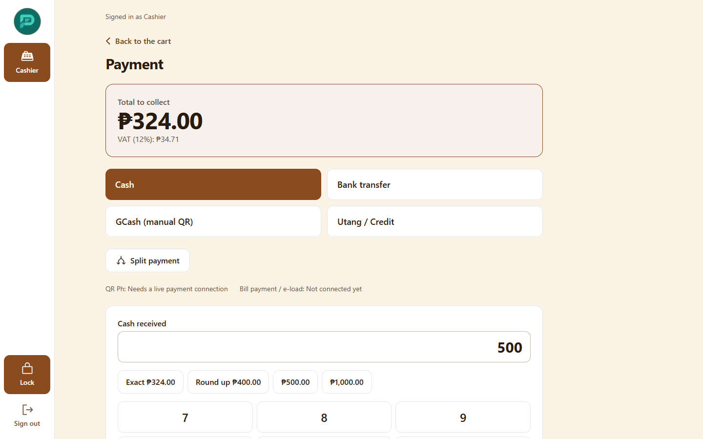

| Method | How it works |
|---|---|
| **Cash** | Use the keypad or quick amounts, or **Round up**. The change to give is shown. |
| **Bank transfer** | Record the reference, confirm when the money arrives. |
| **GCash** | Shows the branch's manual QR (set under Branches). Confirm when the customer has paid. Only appears if a QR is set up. |
| **Utang / Credit** | Pick the customer's account. The system stops the sale if it would pass the credit limit. A Manager or Admin PIN can override the limit. Only one utang part per sale. |
| **Split payment** | Use **Add payment** for each part: method, amount, optional reference. The screen shows **Remaining** and **Change to give**. Only a cash part can be more than what is due. |

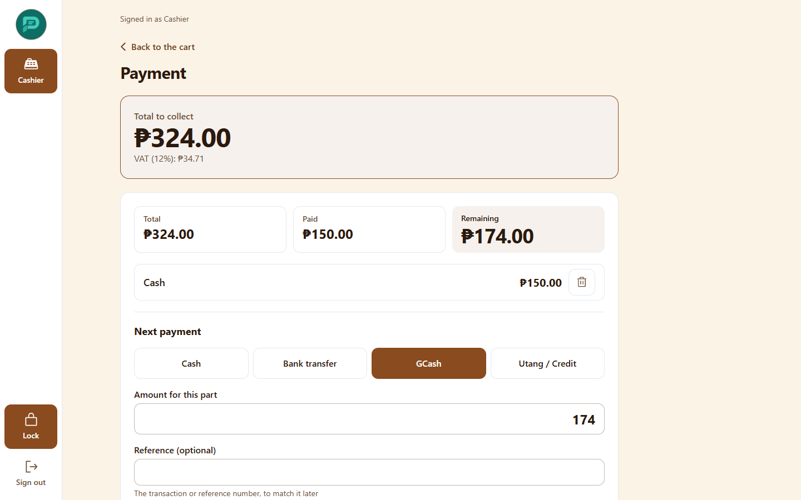

QR Ph and bill payment / e-load are listed but not available yet ("Needs a live payment connection", "Not connected yet").

If the connection drops while paying, do not tap twice. Wait, then look the sale up with **Find order**; payments are protected against double charging.

## Receipt

After payment the receipt shows "OFFICIAL RECEIPT", VATable, VAT-exempt and zero-rated amounts, the SC/PWD name and ID, and your business TIN. Choose **Print** or **New sale**.

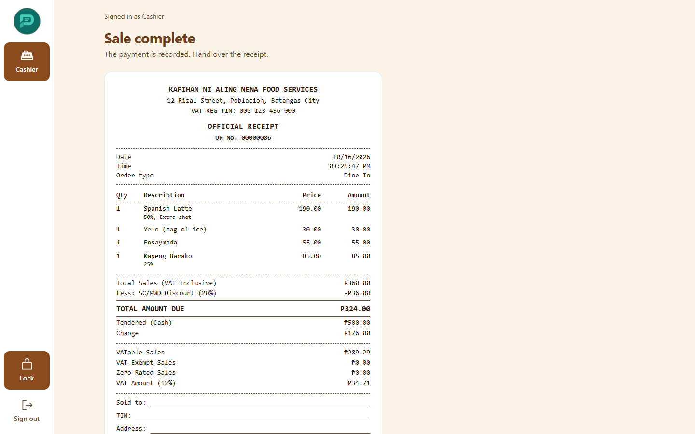

Receipt numbers are strictly sequential for each register. They never skip and cannot be edited, as BIR requires.

## Find a sale, refund, exchange

- **Find order** (**More** menu): enter the **Receipt number**.

  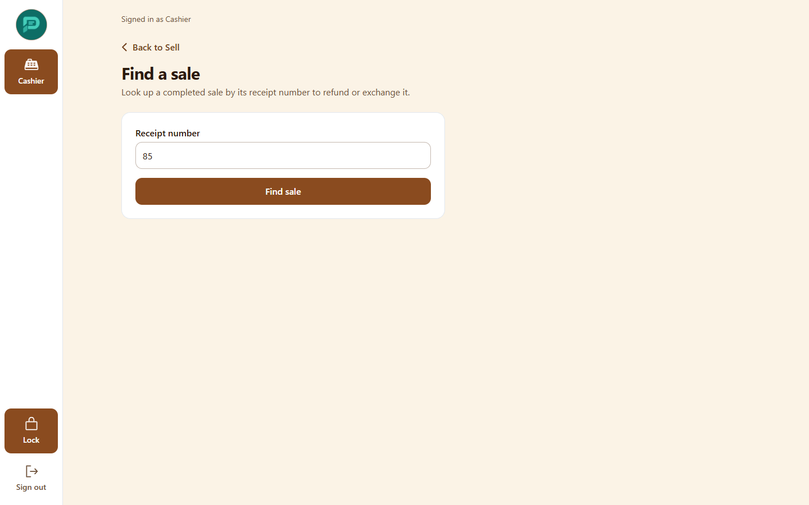

- **Refund** (on the receipt or found sale): choose a **Reason** and have a Manager or Admin enter their PIN. The whole sale is marked Refunded and stock returns.

  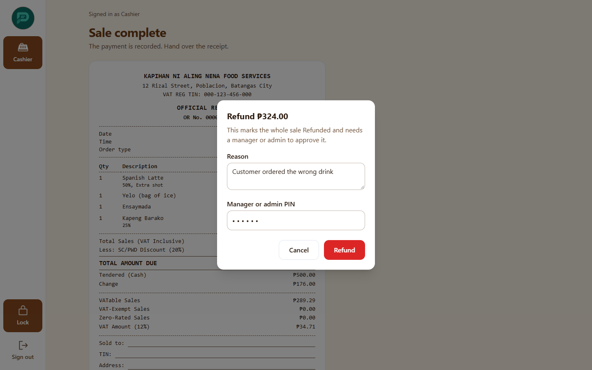

- **Exchange**: list what **Came back** and what was **Taken instead**. The screen shows the **Difference**: either "Customer pays" (with **Cash received**) or "Refund to customer". An even exchange is allowed. A reason and a Manager or Admin PIN are required.

  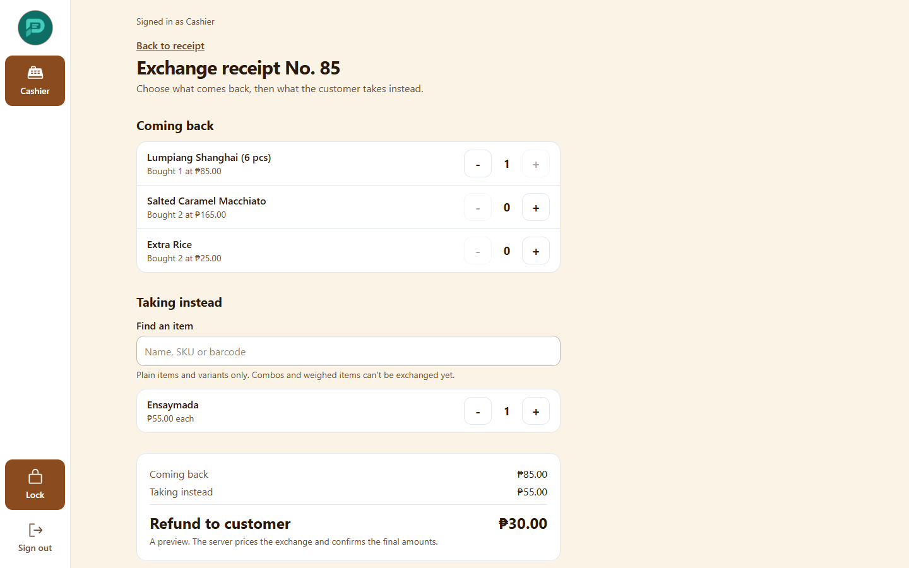

## Kiosk orders

Customers who order at a kiosk pay at the counter. Choose **Kiosk** (top bar of the register) to see the waiting orders (the list refreshes by itself). Opening one makes it your cart.

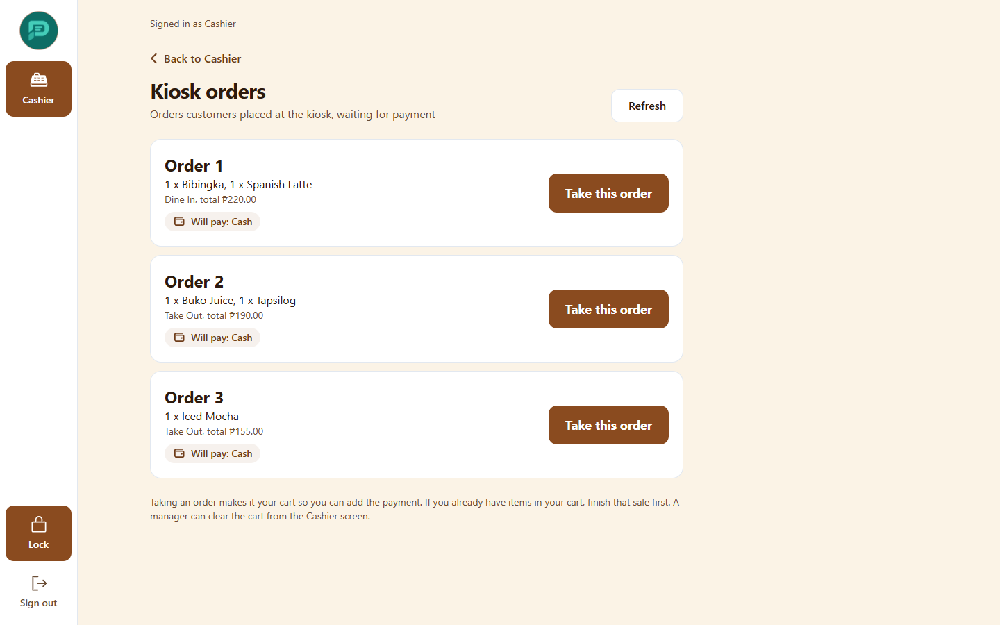

## Close your shift

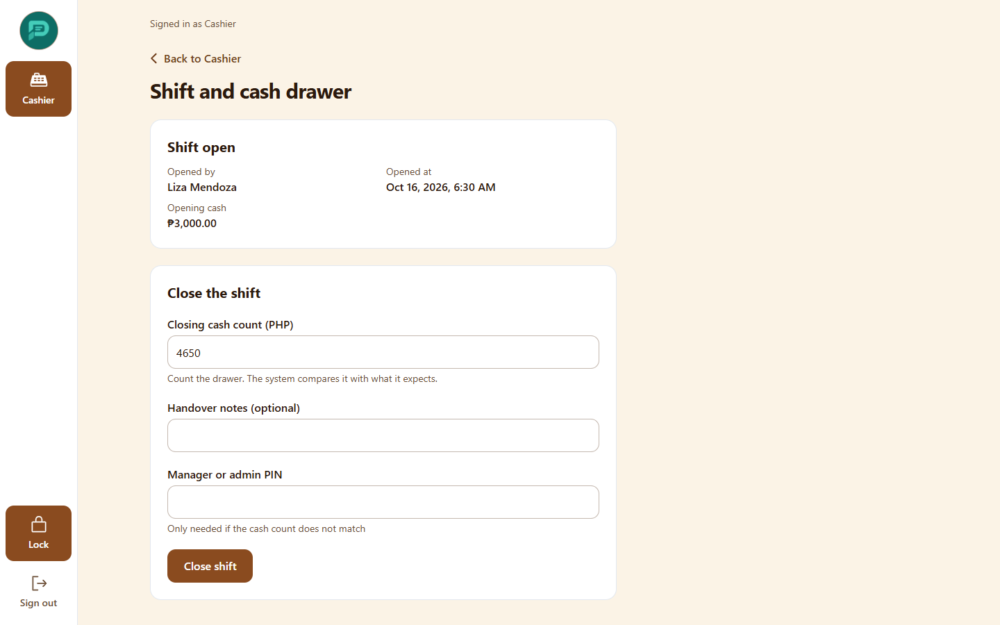

- **X-reading** (in Reports, see below) can be taken at any time. It shows the sales so far without closing anything.
- **Close shift**: count the drawer and enter the **Closing cash count**. Add **Handover notes** if needed. If the count does not match the expected cash, a Manager or Admin PIN is required. The count is blind: the expected amount is not shown before you enter yours.
- When the shift is closed, the screen shows **Shift closed** with Opening cash, Expected cash and Counted cash, and who approved a difference.
- **Z-reading** closes the day for BIR. It shows the grand accumulated total before and after, the reset counter and any missing receipt numbers. Take it from Reports with **Take Z-reading** (see [Reports](05-reports.md)).
