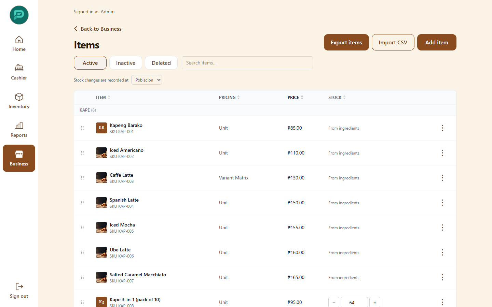
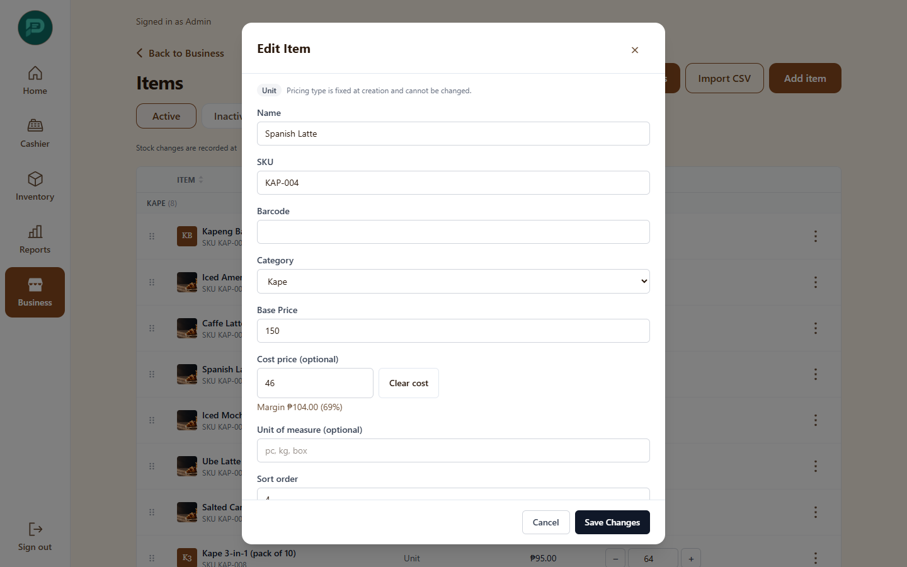
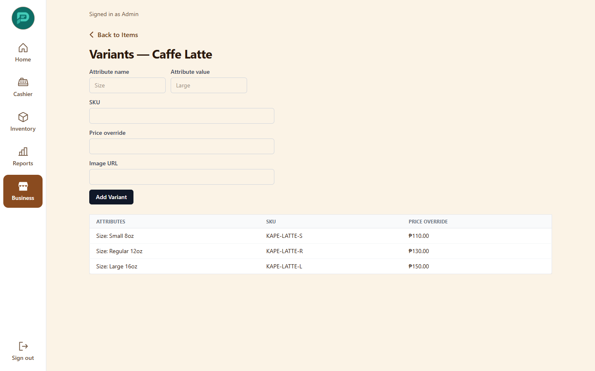
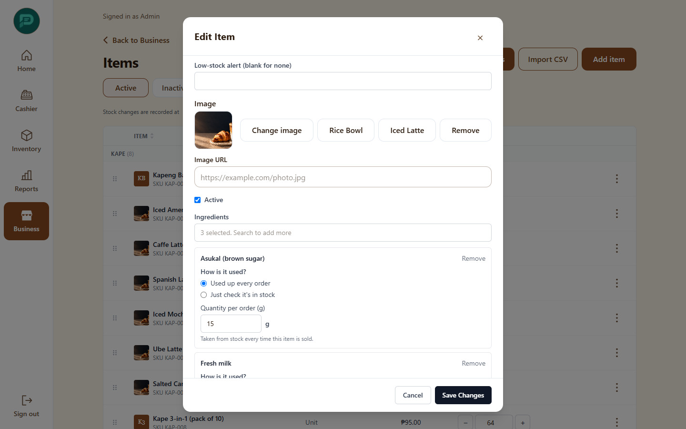
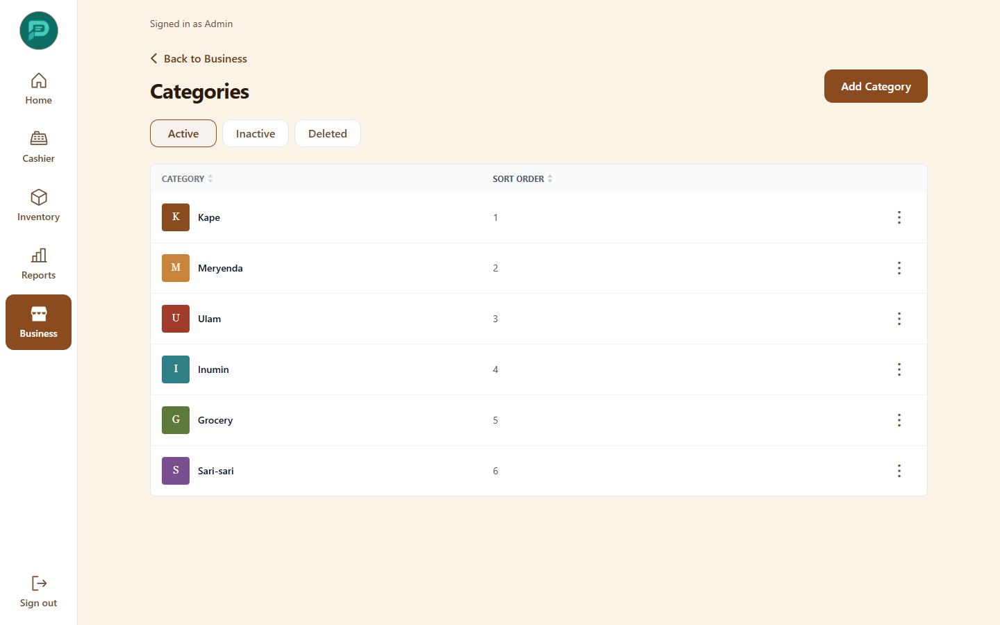
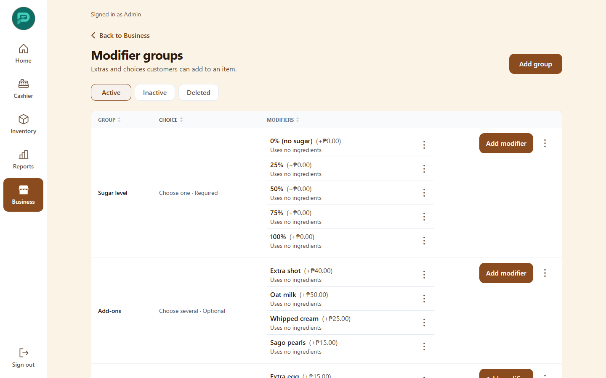
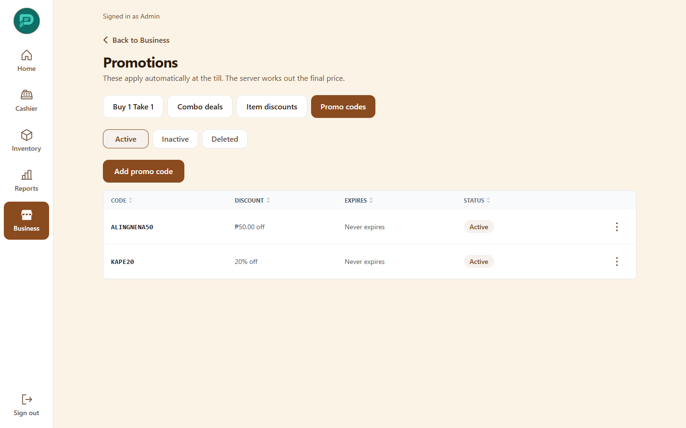
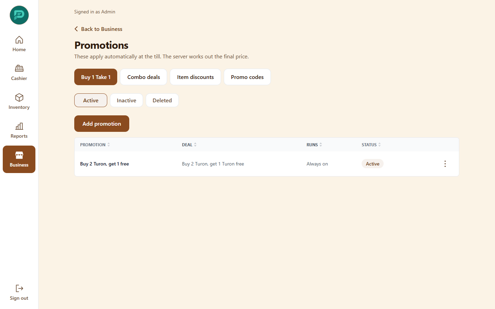

# 3. Items, categories and promotions

Open **Business** then **Items** (or the Items tile in **Inventory**). Admins, Managers and Warehouse staff can edit items; Cashiers can only see them.

## Items

Search by name, SKU or barcode and filter by category. Choose **Add item** or open an item to edit.

| Field | Meaning |
|---|---|
| Name, SKU, Barcode | SKU and barcode are used for scanning and for imports. If "Require a barcode on every item" is on in settings, a barcode is mandatory. |
| Category | Groups items on the register. |
| Base Price | The selling price in pesos. |
| Cost price | What the item costs you. Optional. Used for margin and stock value; hidden from Cashiers. A margin hint appears next to it. **Clear cost** removes it. |
| Pricing Type | **Unit**, **Weight / Volume**, **Bundle / Promo**, **Service / Appointment**, **Combo / Meal**, **Variant Matrix**. |
| Unit of measure | How the item is counted. |
| Image | Shown on the register and the kiosk. Up to 5 MB (PNG, JPEG, WEBP or GIF). |
| Low-stock alert | Quantity at which the item shows as running low. |

Each item has extra pages, opened from the row menu:

- **Batches**: lot numbers and expiry dates.
- **Tingi settings**: sell by the piece from a pack, using **Fixed sizes** or an **Increment step**, and how many units are in a pack.
- **Bundle rules**: price for a group, such as 3 for ₱50.
- **Service duration**: minutes a service takes.
- **Variants**: size, flavor and similar choices, each with its own price and stock.

  

- **Combo parts**: the slots of a meal (drink, side) and any upcharge.
- **Modifier groups**: attach add-on groups.
- **Department**: assign the item to a concessionaire department.
- **Recipe** (when "Track ingredients separately" is on): which ingredients and how much each sale uses.

  

**Export items** downloads a CSV. To change many items at once, see [Import](04-inventory.md#import-and-export).

### Deactivate or delete

Use the row menu (⋯). **Make inactive** hides an item from the register but keeps its history. **Delete** only works when nothing depends on the item; the dialog explains what would be affected. Inactive and deleted items can be restored from the status filter.

## Categories

Add, rename and reorder categories. Reordering changes the order on the register.

## Modifier groups (add-ons and choices)

A group is a set of choices, such as "Sugar level" or "Add-ons". Set whether choosing is **required** and whether **more than one** can be picked. Add the choices with an optional price change.

Then attach the group to items from the item's **Modifier groups** page.

## Promotions

Open **Business** then **Promotions**. Promotions apply automatically at the register. Each has start and end dates and can be made active or inactive.

| Tab | What it does |
|---|---|
| **Buy 1 Take 1** | Buy one, get one free on chosen items. |
| **Combo deals** | A fixed price when two chosen items are bought together. |
| **Item discounts** | Percentage off, amount off, or a set price on an item. |
| **Promo codes** | A code the cashier types. Choose **Add promo code**, set a percentage or amount off. |

One unit never gets two promotions. Senior/PWD and manual discounts replace promotions on the same sale.
