# 4. Inventory and purchasing

Open the **Inventory** tab. Admins, Managers and Warehouse staff can use it. The tiles are grouped as Stock, Procurement and Catalog; some tiles (Items, Categories, Stock valuation) are for Managers and Admins only.

Stock is counted for the whole business, not per branch. Branch transfers move stock between branches for record keeping.

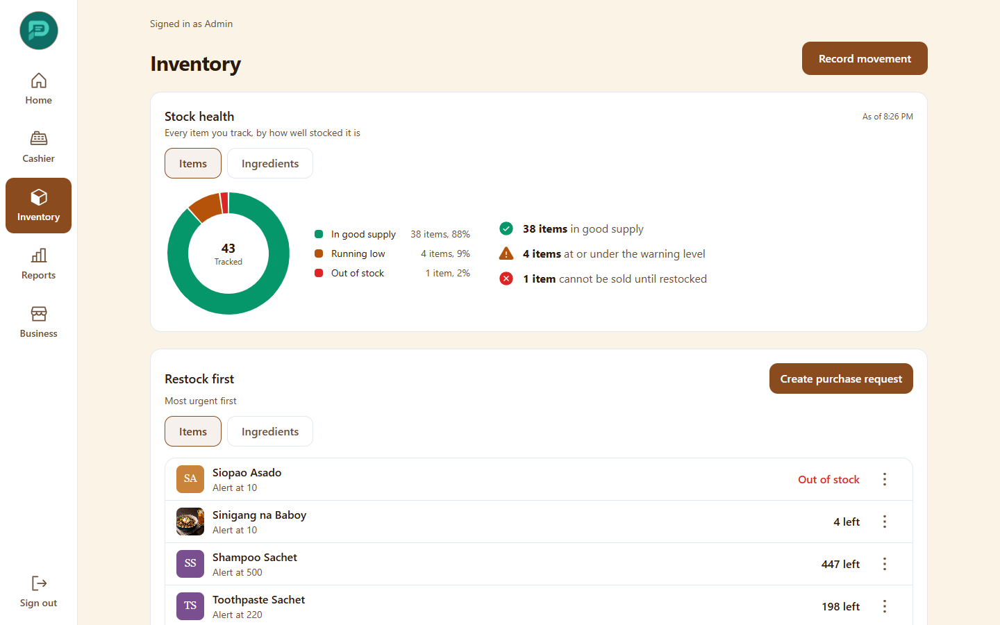

The top of the page shows how many items are running low or out of stock and which are closest to running out. The restock list ("Restock first", "Needs restocking") can start a purchase request.

## Stock movements

**Movements** is the log of everything that changed stock: deliveries, sales, damage, counts.

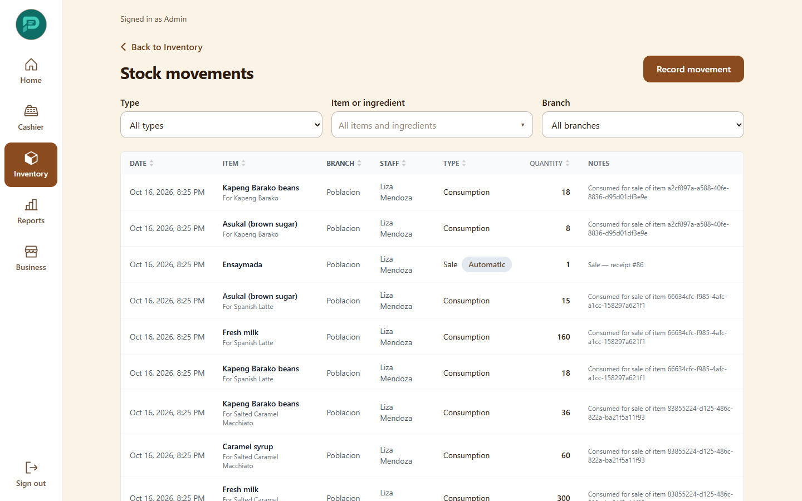

Filter by type, branch and item or ingredient. To record one, choose **Record movement**.

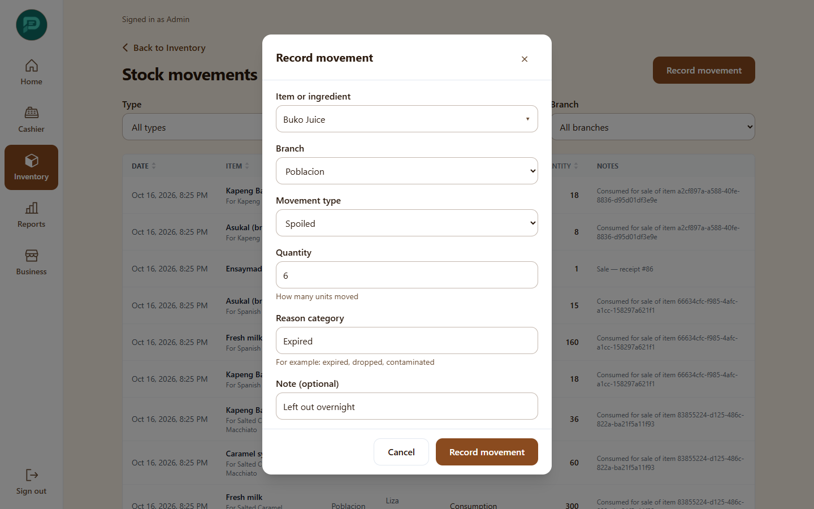

| Field | Notes |
|---|---|
| Movement type | Stock-In, Stock-Out, Consumption, Spoiled, Damaged, For Return, Transfer, Adjustment, Sale |
| Branch | Where it happened |
| Item or ingredient | Search the grouped list |
| Quantity | |
| Reason category | Required for Spoiled |
| Supplier reference, Note | Optional but helpful |

Movements are never edited. Fix a mistake with another movement.

## Ingredients and recipes

Turn on "Track ingredients separately" under business settings to sell finished products while stock is kept as raw ingredients (for example coffee beans, milk).

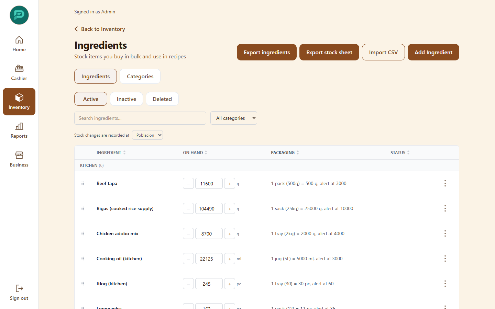

- **Add ingredient** with its unit and low-stock level.
- **Receive delivery** records packs received and converts them to your counting unit.
- Each ingredient row has **Edit**, **Make active or inactive**, **Delete**, and a count action to correct stock after a physical count.
- Link ingredients to a finished item on the item's recipe page. Each sale then uses up the ingredients automatically.
- **Equipment** lists machines, furniture and utensils, with an out-of-service status.

Use **Export ingredients** and **Export stock sheet** for CSV copies.

## Suppliers

Keep a list of suppliers and their contacts. From an item you can set which suppliers sell it and the usual unit cost.

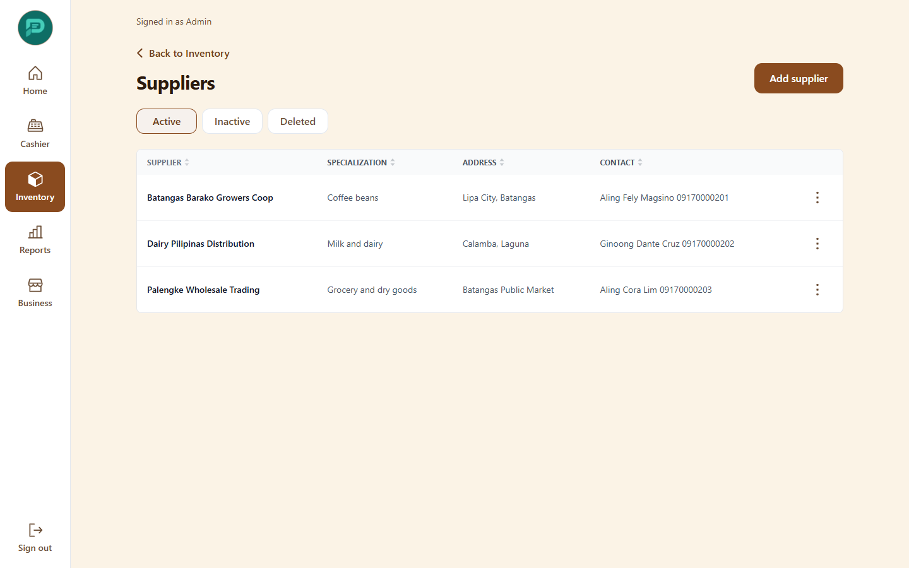

## Purchase requests and orders

1. On the Inventory home, choose **Request purchase** from the restock list, or create a request under **Purchase requests**. It lists items and quantities needed.

   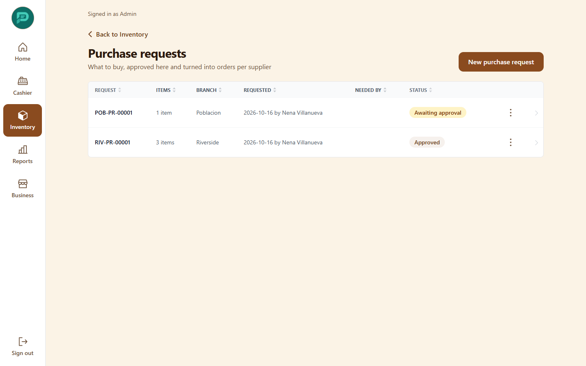

2. A request starts as "Awaiting approval". An Admin or Manager **approves** it, then **converts** it into purchase orders, one per supplier (the request then shows "Ordered").
3. A **purchase order** has Supplier, Deliver to branch, Date needed, items with quantity and unit cost, a discount for the whole order and remarks. Statuses: Draft, Submitted, Partially delivered, Delivered, Cancelled. **Submit order** moves it from Draft to Submitted; **Print** gives a copy for the supplier.

   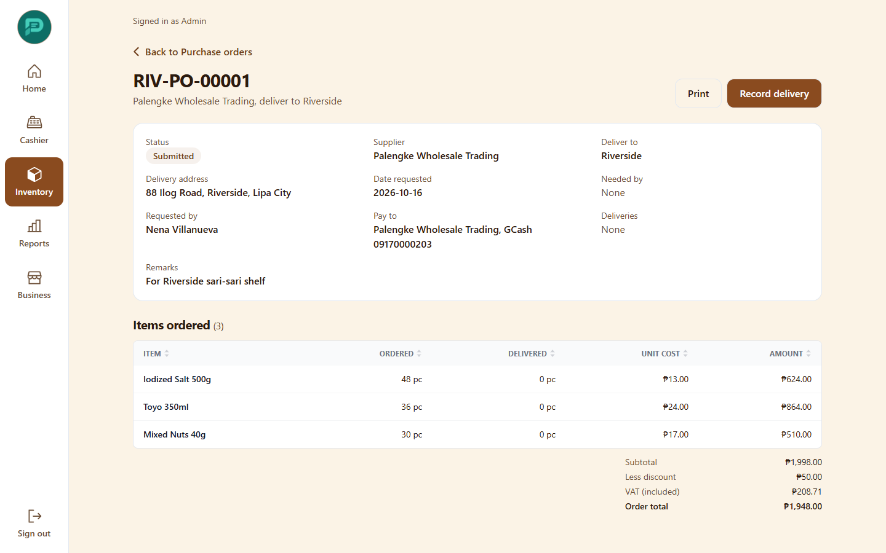

## Receiving a delivery

Under **Incoming receiving**, choose **Record a delivery**: date, supplier, optional purchase order and each line's condition: **Accepted**, **Not good** or **Rejected**. Rejected items do not add stock. Linking a delivery to a purchase order afterward is for Admins and Managers.

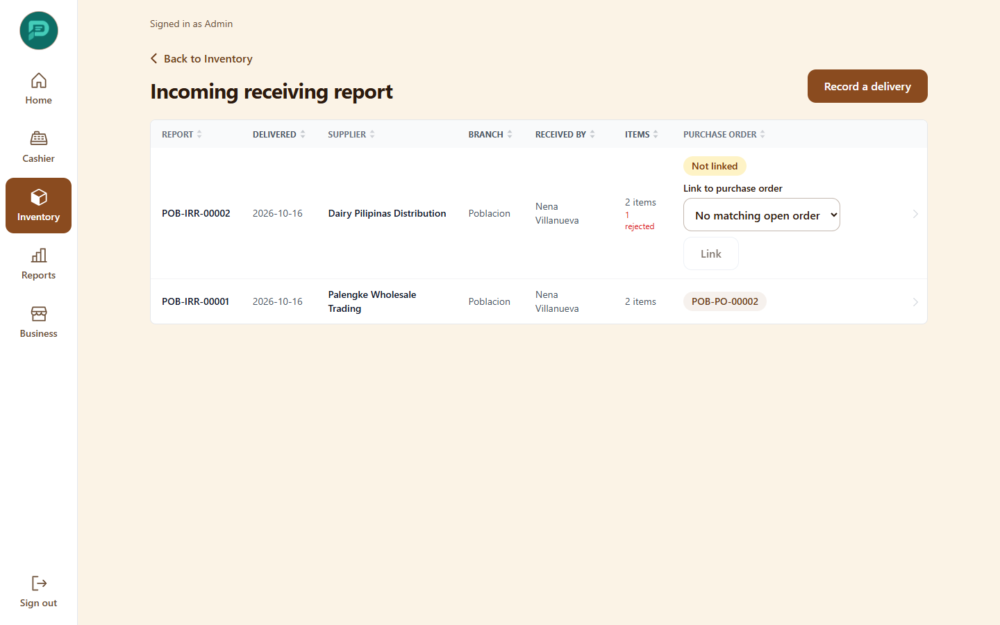

If "Update item cost when stock is received" is on, the latest price becomes the item's cost.

## Transfers between branches

Choose **New transfer**: Send from, Send to, item or ingredient and quantity. Statuses: Pending, In transit, Received, Cancelled. Marking it in transit takes stock off the sender; marking it received adds it to the receiver. Cancelling an in-transit transfer puts stock back.

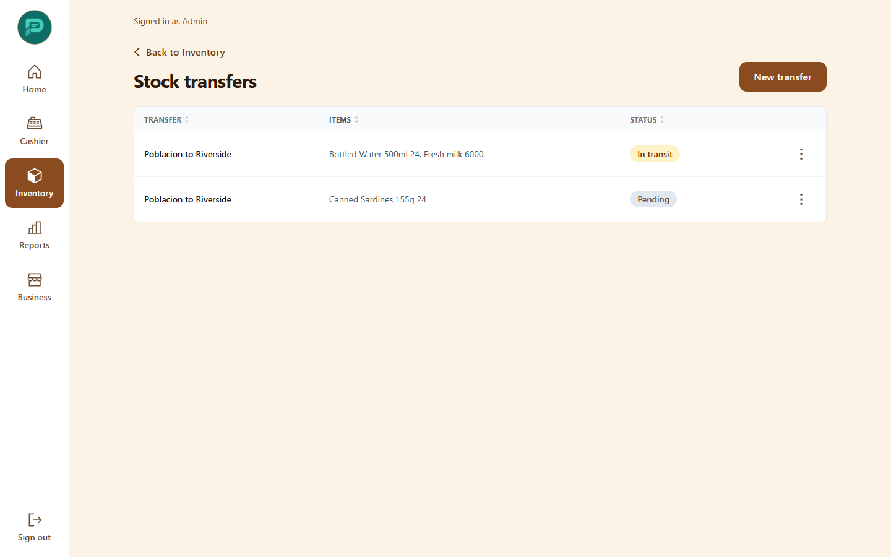

## Stock counts (stock-take)

A stock-take is a counting session with a record of what was missing or extra.

1. **New stock take**: give it a **Name**, choose **What to count** (Everything, Chosen categories, or Chosen items and ingredients) and optionally **Blind** so counters do not see the expected numbers.
2. **Start** the count. Counters enter the quantity for each line. Lines for which stock moved after the count are flagged **Needs recount**. Sales are not blocked during a count.

   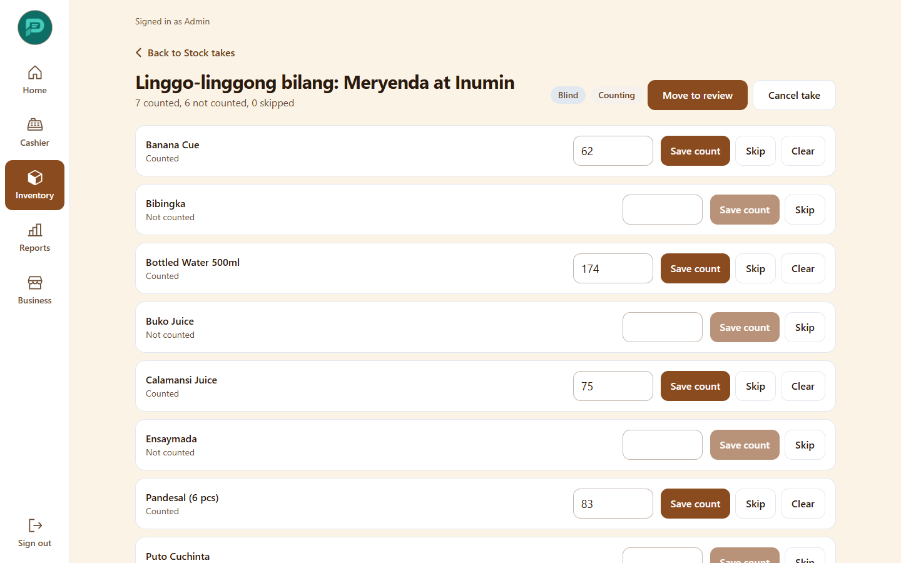

3. A Manager or Admin moves the count to **Review**. The review shows Expected, Counted, Variance and the **Value impact** in pesos.

   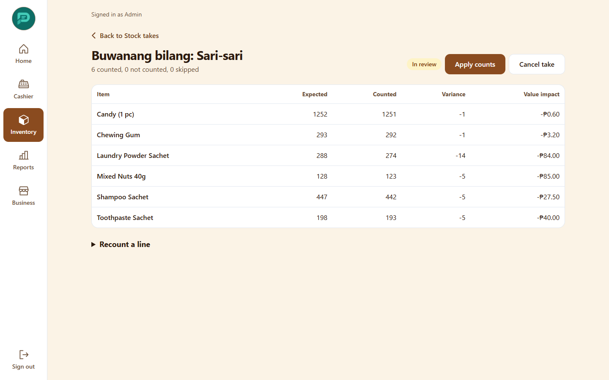

4. **Apply counts** adjusts stock by the difference (counted minus what was expected at the time of counting). A Manager or Admin PIN is needed. Applying twice does nothing the second time. The result is written to the audit log; stock can go negative if the count was lower than recorded sales.

A count can be cancelled before it is applied.

## Import and export

Use import to load a catalog or opening stock from a spreadsheet. It never changes anything until you confirm.

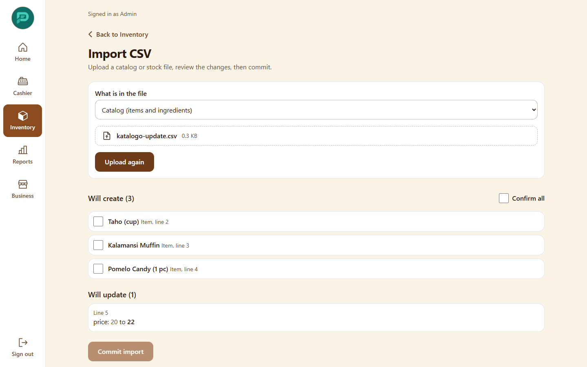

1. Choose **Import CSV** and decide **What is in the file**: **Catalog** (items and ingredients) or **Stock counts**. Stock counts also need the **Record stock at branch**.
2. Upload the file (up to 5,000 rows or 5 MB). Start from an export so the columns match.
3. Review the preview. Rows are matched by SKU, then barcode, then name. Similar names show up as **near matches** for you to decide: link to the existing item, create a new one, or rename.
4. Fix rows marked with errors (negative prices or quantities, opening stock on an existing item).
5. **Commit.** Everything saves or nothing does. A Manager or Admin PIN is required. Stock imports add movements; they do not overwrite quantities.

Exports (items, ingredients, stock) are CSV. Spreadsheet formulas in text cells are neutralized so the file is safe to open.
