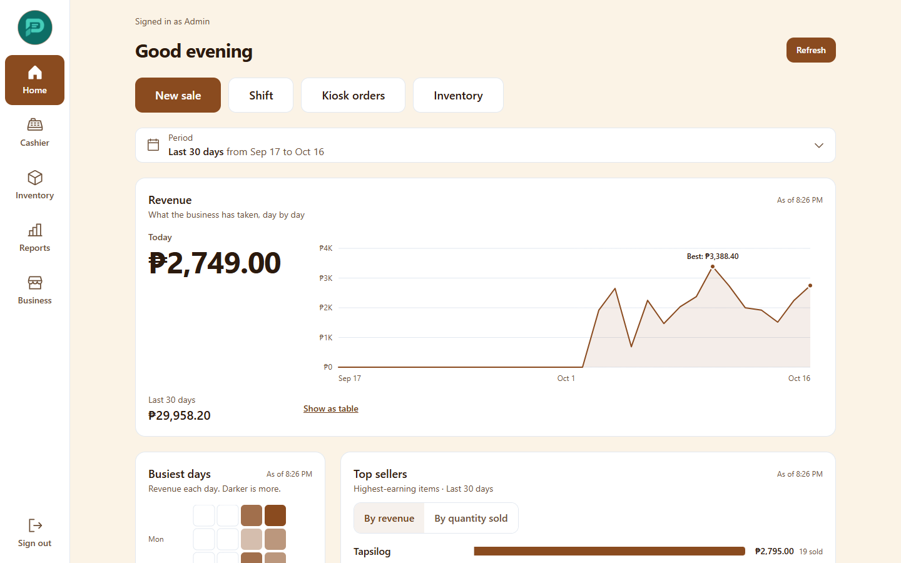
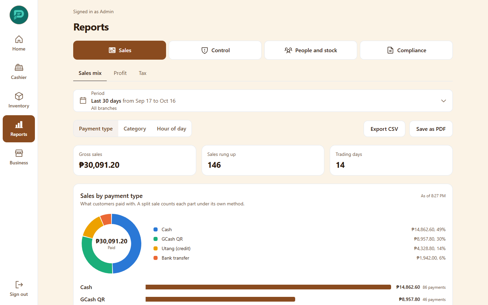
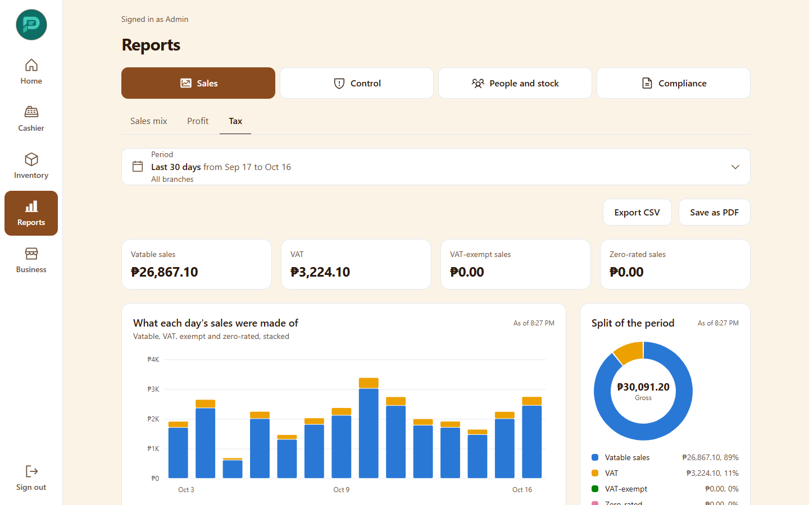
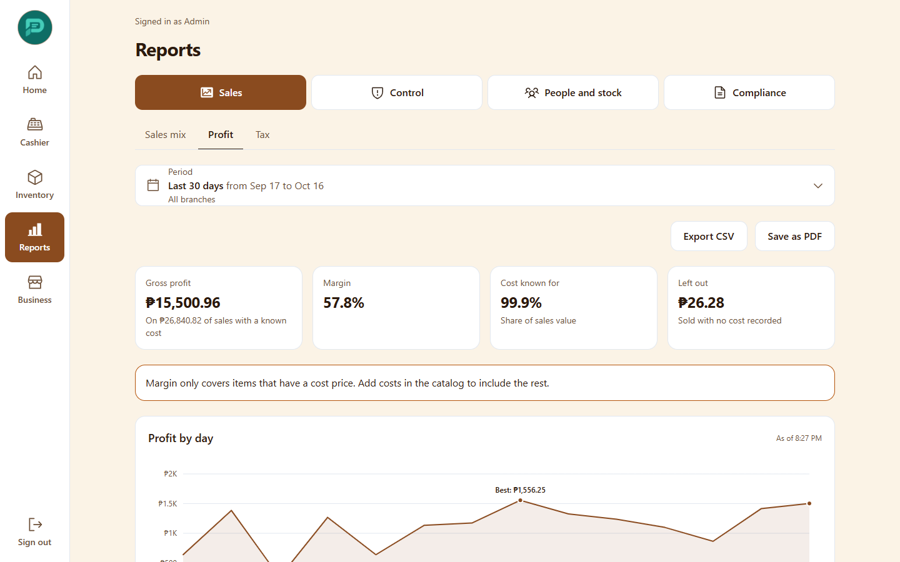
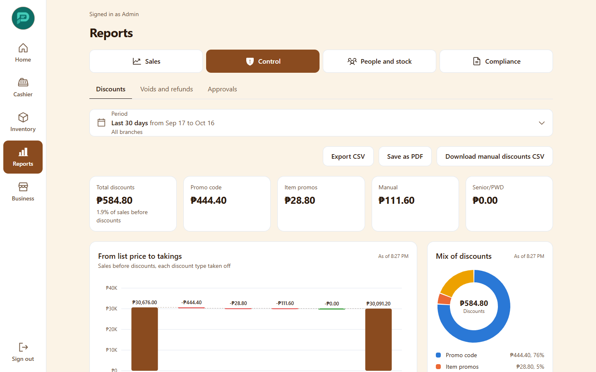
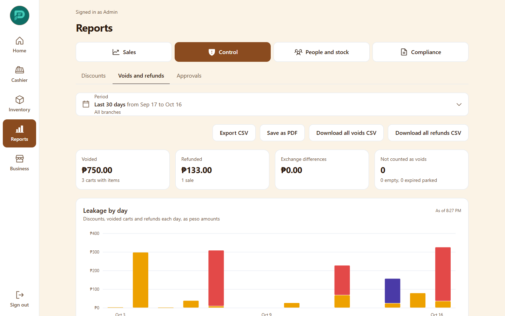
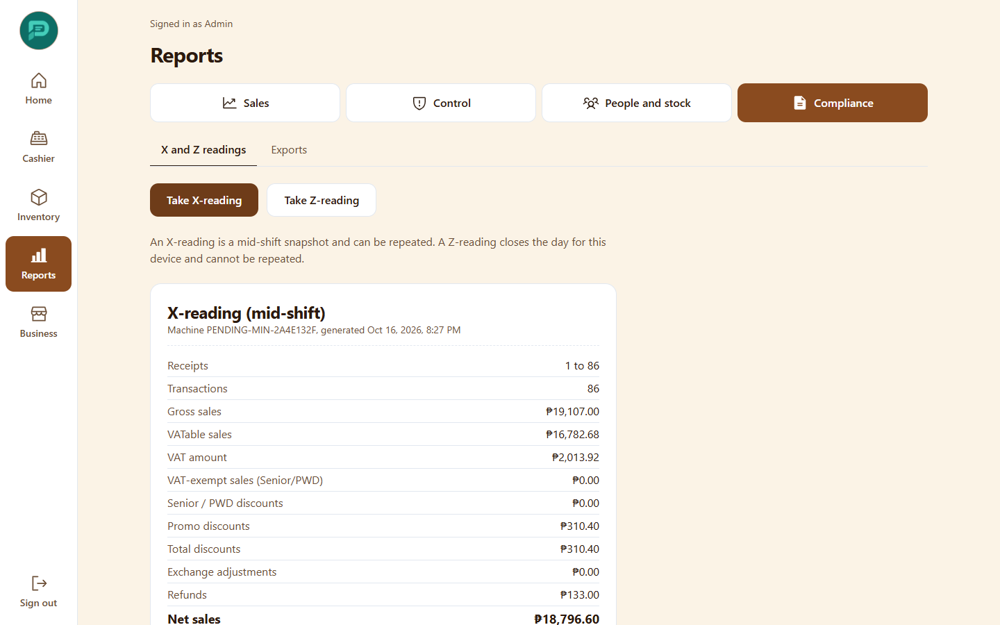
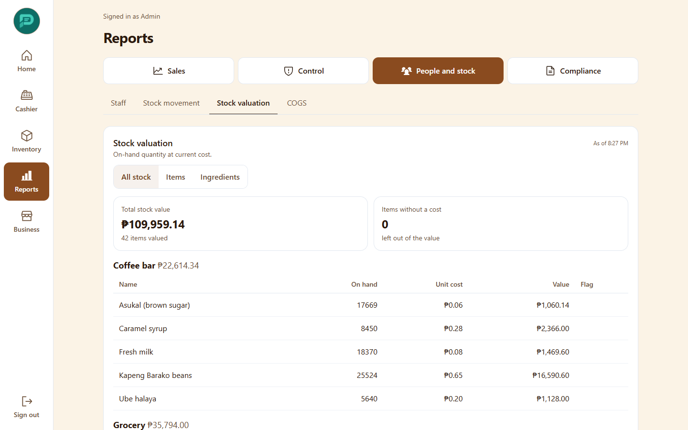
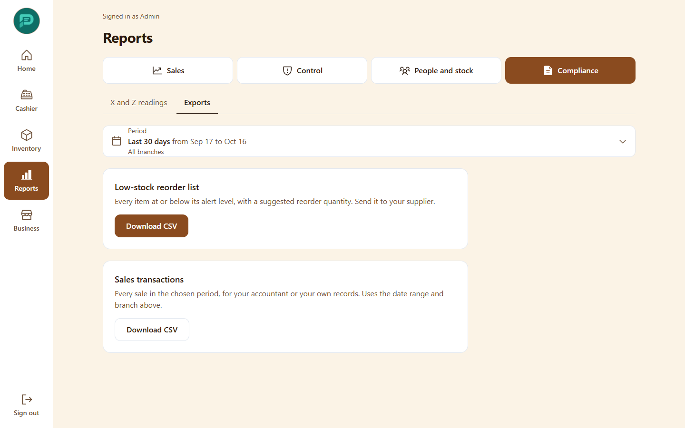

# 5. Reports

Open the **Reports** tab (Admins and Managers). Warehouse staff can see stock valuation and cost of goods. Reports are in four groups across the top: **Sales** (Sales mix, Profit, Tax), **Control** (Discounts, Voids and refunds, Approvals), **People and stock** (Staff, Departments, Stock movement, Stock valuation, COGS) and **Compliance** (X and Z readings, Exports). A **Period** control and a branch selector sit above each report. Most reports have **Export CSV** and **Save as PDF** (opens your browser's print window; choose "Save as PDF" there).

The **Home** tab also has a quick overview: revenue with a period filter, top sellers, busiest days, gross margin, revenue by branch, category share, stock health, sales leakage and "Payments due soon" (customer credit due within 7 days or overdue).

## Sales mix

Sales broken down by payment type, category and hour of the day. Times use Philippine time.

A sale paid in several ways counts each part under its own payment type. Cash is shown net of change given. Utang is credit, not cash.

## Tax

VATable sales, VAT, VAT-exempt (Senior/PWD) and zero-rated sales for the period, as recorded when each sale was completed.

Older sales created before tax tracking show a note that their VAT was worked out later using the 12% rule. Daily totals here can differ from the Z-reading by a few centavos because of rounding; the Z-reading is the BIR record.

## Profit

Gross profit and margin from the cost recorded on each sale.

Sales of items with no cost, and open items, are left out of margin and counted separately so you can see how complete the figure is.

## Discounts

Discounts by type (promo code, item promotion, manual, Senior/PWD), by cashier and by the manager who approved.

## Voids and refunds

Cancelled carts and refunded sales with reasons and who approved them. Parked carts that simply expired are not counted as voids.

## X and Z readings (BIR)

- **Take X-reading**: a mid-day summary of this register's sales. Can be repeated.
- **Take Z-reading**: the end-of-day close for this device. It cannot be repeated and resets the daily counter. Do it once, when the day's selling is done.

## Staff and departments

**Staff** shows sales volume and average sale per person, plus shifts opened. **Departments** (only when department tracking is on) splits sales for concessionaires.

## Stock movement, valuation and COGS

**Stock movement** summarizes in, out and adjustments. **Stock valuation** is quantity on hand times cost, by category; items with no cost are excluded and counted. **COGS** is the cost of goods sold, from the cost recorded at sale time, after refunds.

## Approvals

A review list of the sensitive actions that needed a manager PIN, so owners can spot unusual patterns.

## Exports

- **Low-stock reorder list** (CSV).
- **Sales transactions** (CSV): Admin only ("Only an admin can export raw sales.").
- Void and refund listings (CSV) are also Admin only.
