# 6. Running the business

Open the **Business** tab. The tiles are grouped as People and places (Staff, Branches, Devices), Selling (Modifier groups, Promotions, Orders, Customers) and Records and settings (Audit log, Sync conflicts, Business settings).

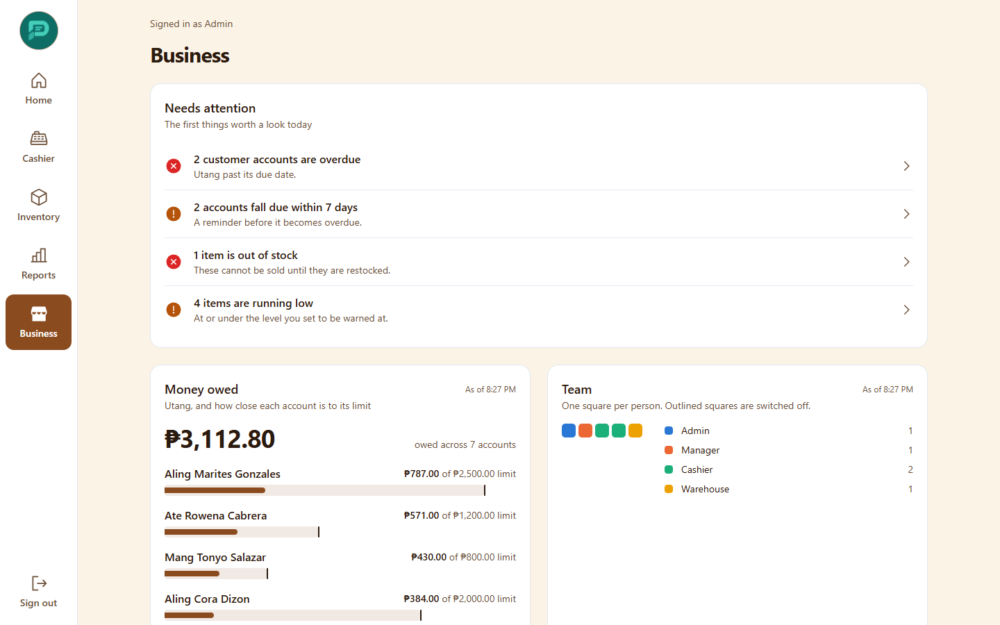

## Staff

Admins can manage everyone; Managers can manage Staff-role members only.

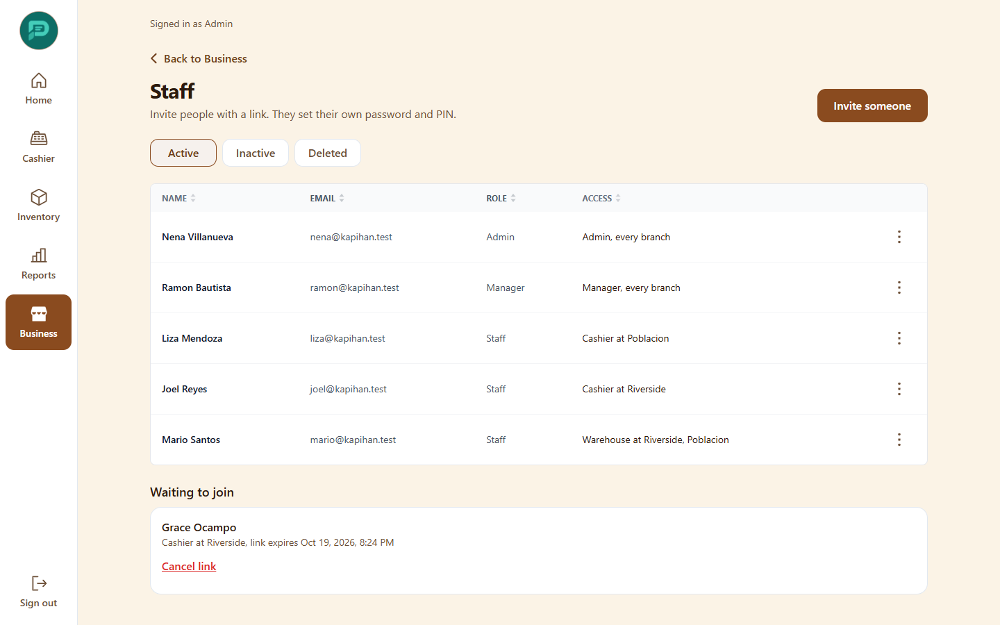

To add someone, choose **Invite**, then fill in:

- **Name** and **Email**
- **Role**: Staff, Manager or Admin (only an Admin can choose Manager or Admin)
- **Can work as**: Cashier, Warehouse or Kitchen
- **Works at**: the branches they may use

You get an invite link to share ([see Getting started](01-getting-started.md#invite-staff)). Pending links can be cancelled. To remove access, use the row menu to make a person inactive; their history stays.

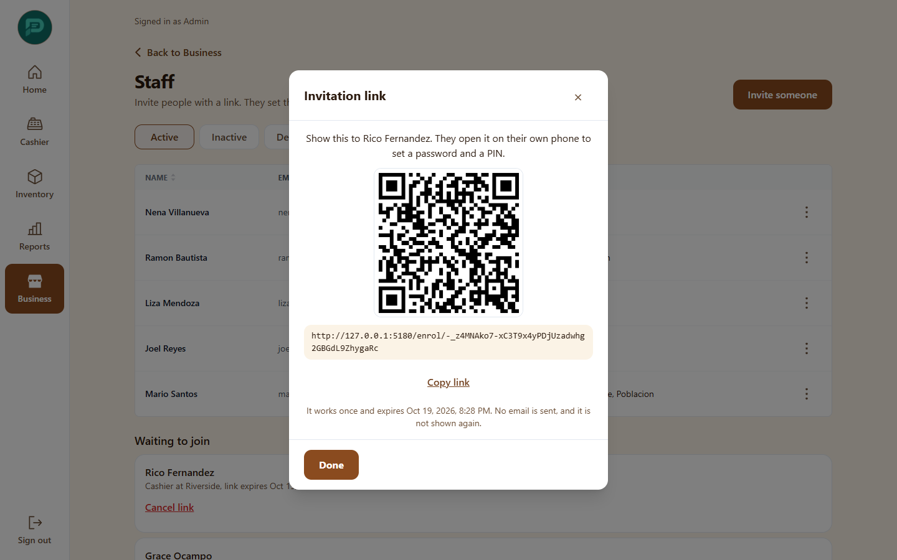

## Branches

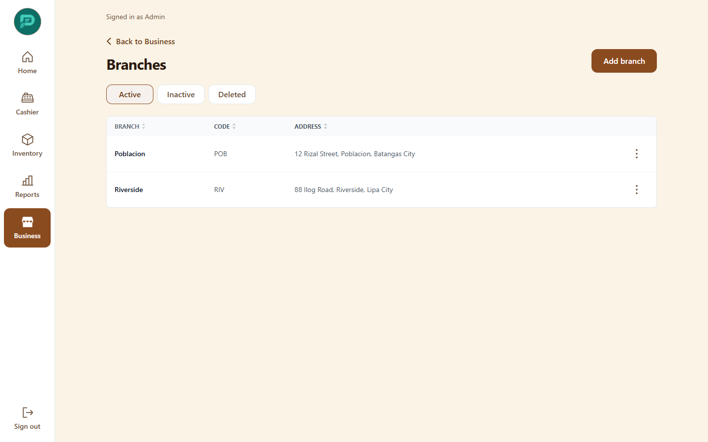

Admins add and edit branches: **Branch code**, **Name**, **Address**. Managers see them read-only ("Only an admin can add or change branches.").

Open a branch for:

- **Hardware settings**: Receipt printer profile (No receipt printer or Thermal), and when the cash drawer opens (only on a paid sale, or also by hand with manager approval).
- **Manual GCash QR**: upload your shop's QR and enter the Account name and Account number. Cashiers show it to customers.
- **Departments**: for concessionaires sharing a counter.

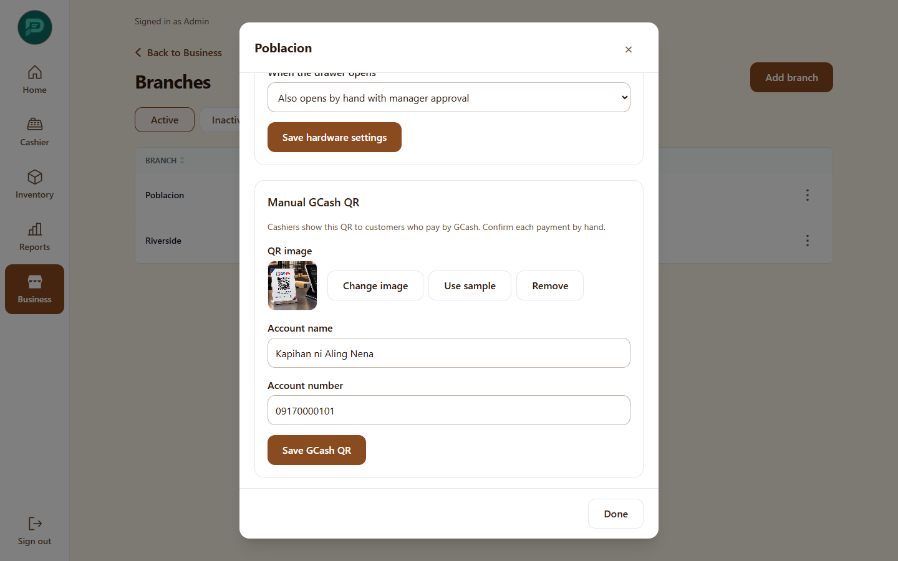

## Devices

Admins only. Add a **Register**, **Kiosk**, **Order board**, **Kitchen display**, **Warehouse officer** or **Customer display** device. Each gets a one-time pairing code ("Enter this code on the device").

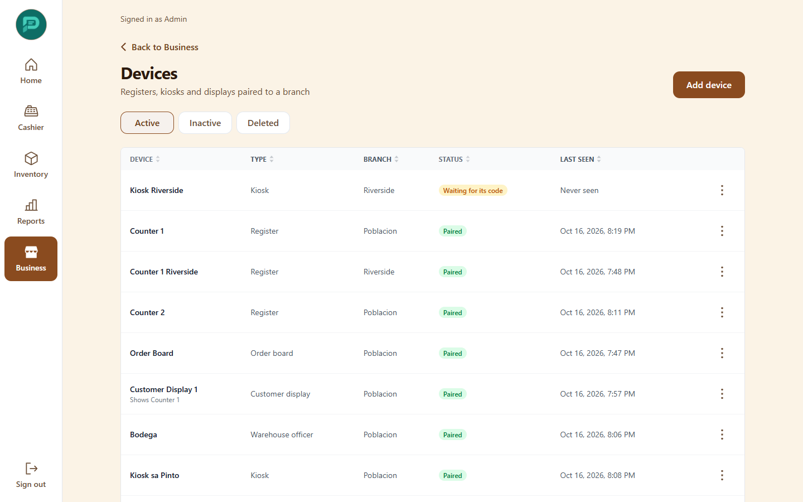

Actions: new pairing code, new device PIN, revoke (the device is signed out), and for a Register, choose which Register a customer display follows.

## Business settings

Admins only.

- **Branding**: logo, colors and font. These apply to the whole app, receipts and the kiosk.

  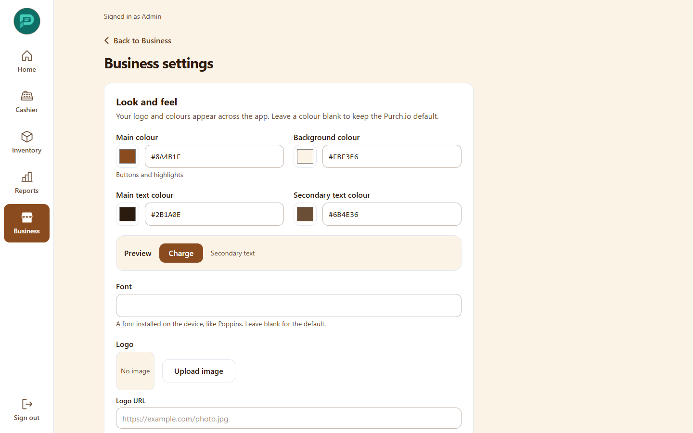

- **BIR details**: registered business name, TIN and address. These print on receipts and X/Z readings. Fill them in before you sell.
- **Country**: the Philippines (PHP, 12% VAT).
- **Options**:

  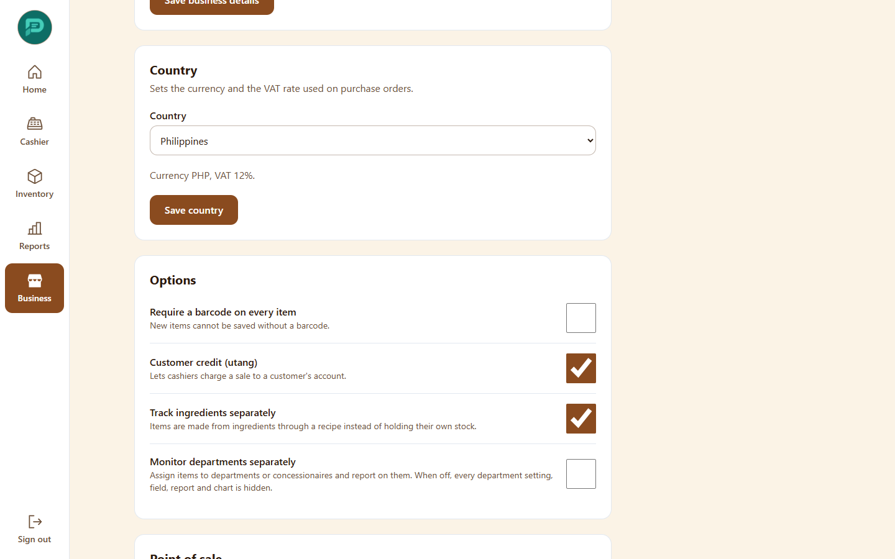

  | Option | Effect |
  |---|---|
  | Customer credit (utang) | Turns the credit feature on. |
  | Keep customer credit records for (days) | How long paid-off credit history is kept. |
  | Track ingredients separately | Recipes consume raw ingredients. |
  | Monitor departments separately | Splits reports by concessionaire. |
  | Update item cost when stock is received | Latest delivery price becomes the item cost. |
  | Require a barcode on every item | Makes barcodes mandatory. |
  | Allow open items | Lets cashiers sell something not in the catalog. |
  | Parked cart keep-for hours | 1 to 168 hours before a parked cart expires. |
  | Kiosk poster | The picture on the kiosk welcome screen. |

## Customers and utang (customer credit)

Utang lets a regular customer take goods now and pay later.

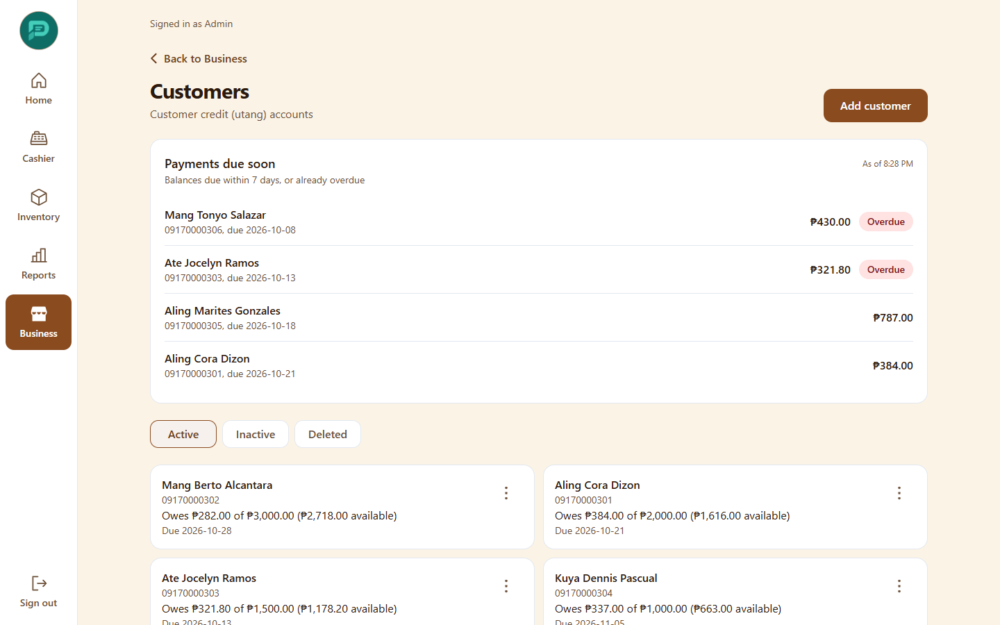

- **Add customer**: Full name, Phone number, Address, **Credit limit**, Due date.
- At the register, choose **Utang / Credit** and the customer's account. If the sale would pass the limit it is stopped; a manager PIN can approve it.
- **Record payment**: **Amount paid** and a Note reduce the balance.
- **Change limit** needs a reason, which is logged.
- Balances due within 7 days or overdue appear on Home as "Payments due soon".
- **Erase details for good** removes the customer's name and phone to meet privacy requests. It only works at a zero balance.

This list is for credit accounts only. Purch.io does not yet keep customer profiles, purchase history or loyalty points.

## Orders

Every sale in one list, with filters for date, payment method and status (Completed, Refunded, Voided, Exchanged). Admins can also filter by branch and device.

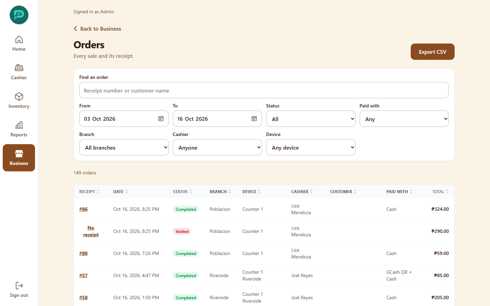

## Audit log

A tamper-evident trail of sensitive actions: voids, refunds, discount and price overrides, stock adjustments and counts, credit-limit changes, manual drawer opens, staff access changes. Filter by date, action, person and branch.

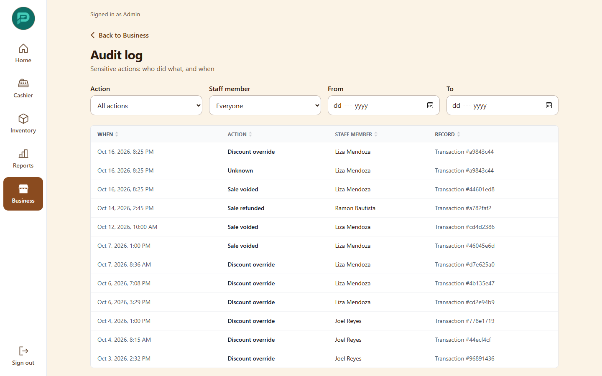

## Sync conflicts

If two devices recorded clashing changes while offline, the later one wins and the earlier is flagged here. Open each item marked **Needs review** and acknowledge it when you have checked. Managers and Admins only.

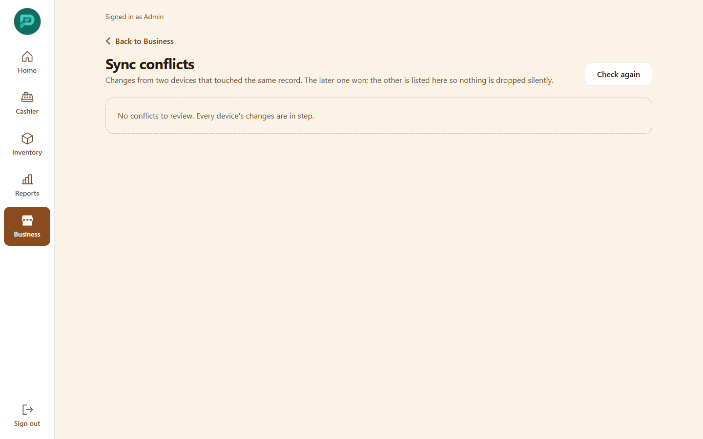
