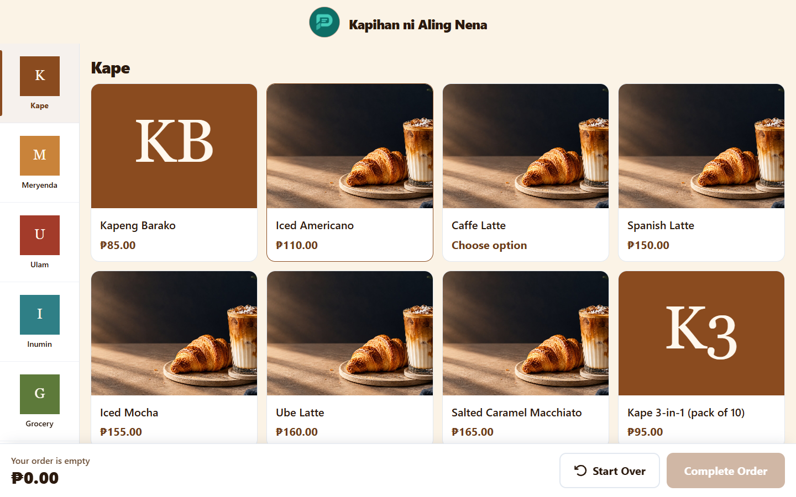
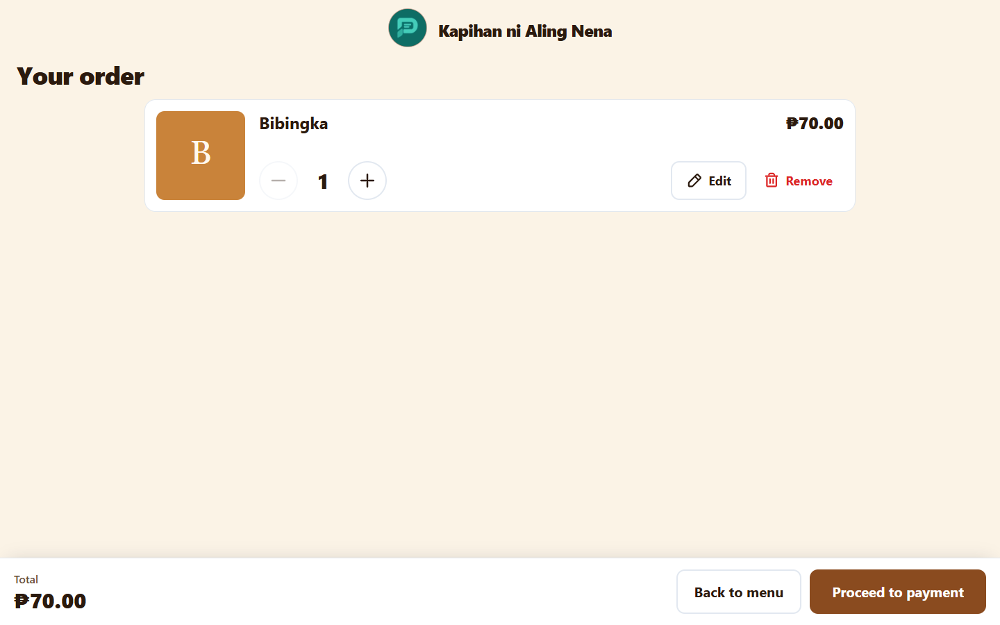
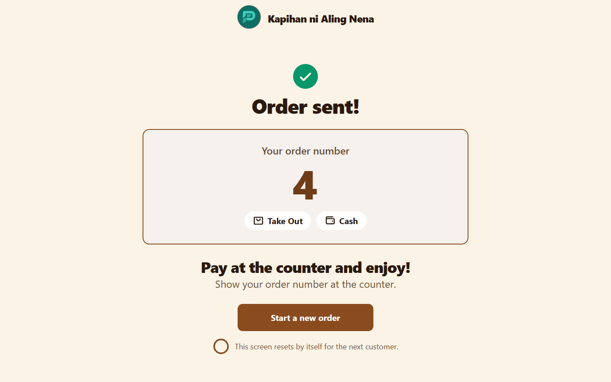
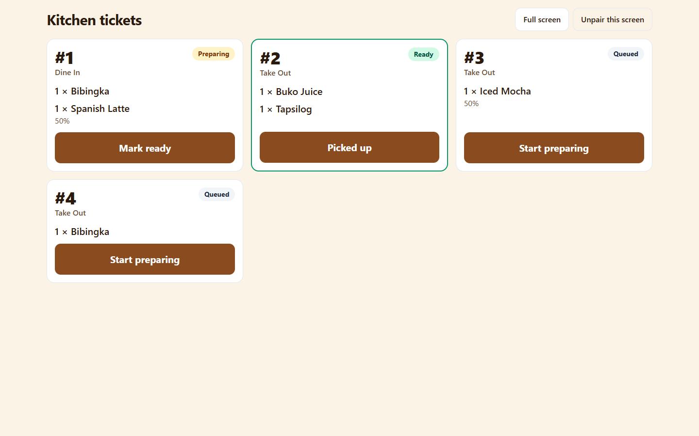
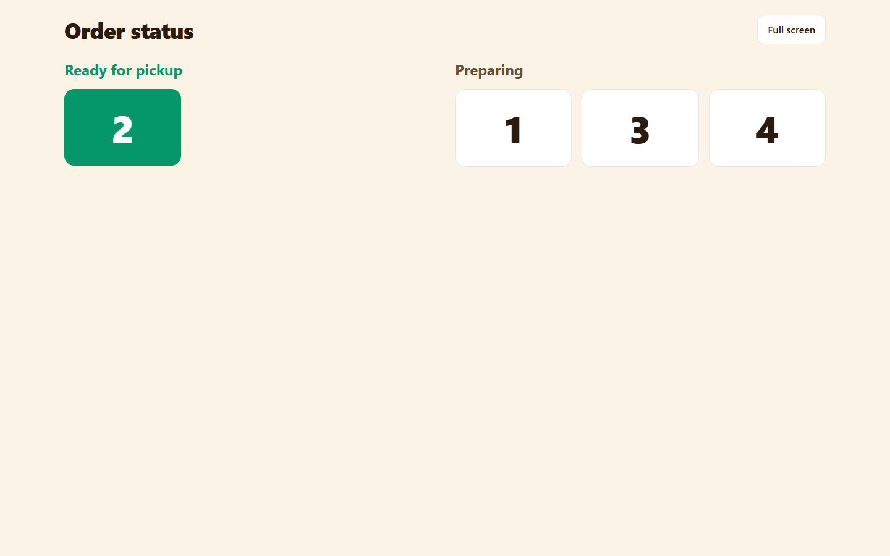
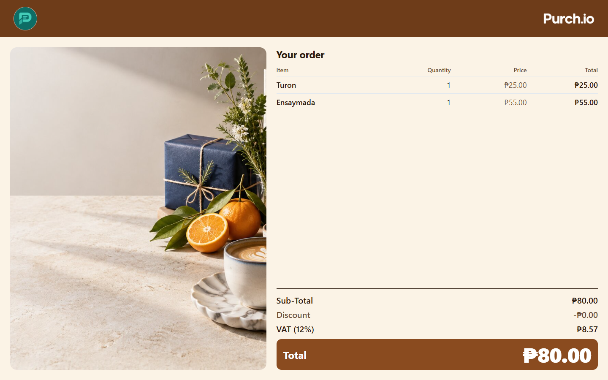
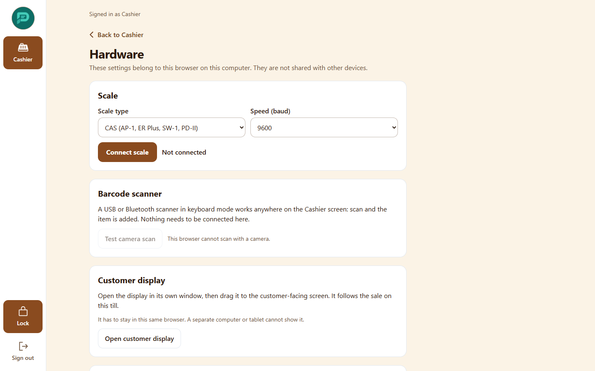
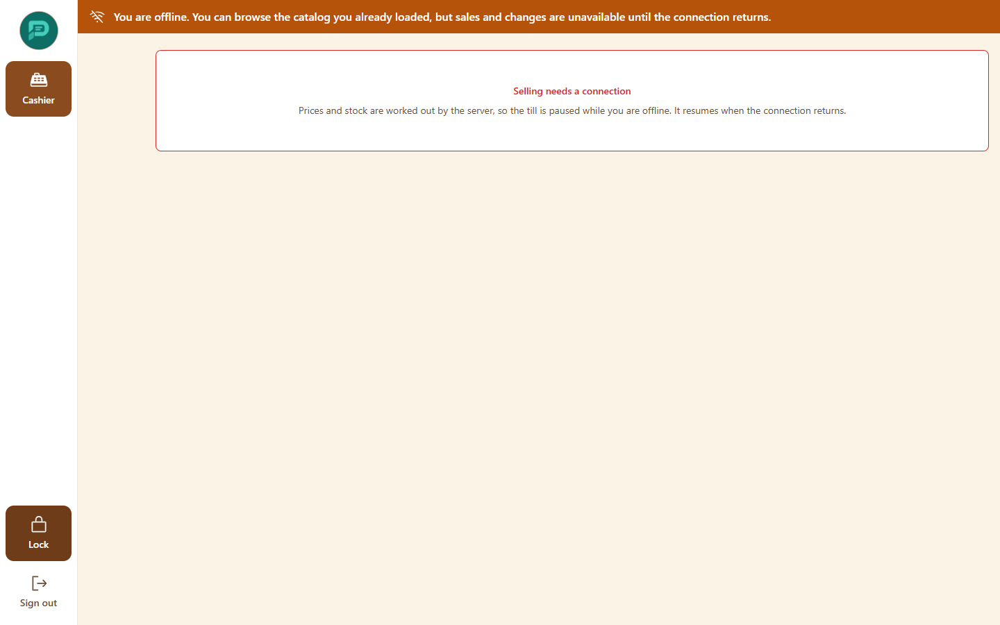
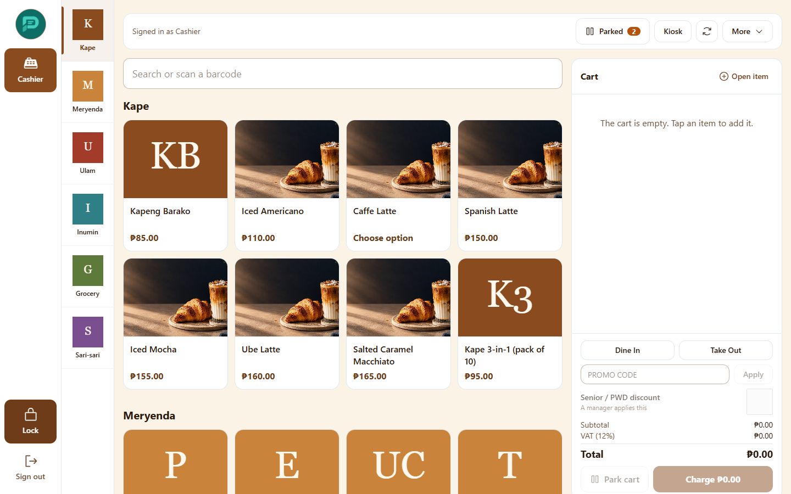

# 7. Kiosk, kitchen screens and hardware

Unattended devices need no staff sign-in. An Admin pairs each one ([Pair a device](01-getting-started.md#pair-a-device)).

## Self-order kiosk

For customers to order without a cashier. A portrait screen is best.

1. **Tap anywhere to begin.**

   

2. Browse the menu and tap an item for its options.

   

3. Review **Your order**, choose **Dine In** or **Take Out**.

   

4. Choose how they will pay. Every choice is paid at the counter. A "Which discount?" step lets Senior/PWD customers say so; they show their ID at the counter.
5. The screen says "Order sent! Pay at the counter and enjoy!" and shows an order number.

   

If nobody touches the screen, it warns after 45 seconds and clears the cart after 60. A hidden **Staff** menu offers **Reset this device** and **Printer setup** for order slips. A cashier opens the order from **Kiosk orders** to take payment.

## Kitchen display

Shows "Kitchen tickets". Tap the big button on a ticket to move it from Queued to Preparing to Ready, then pick up.

## Order board

A read-only screen for customers, with two columns: "Preparing" and "Ready for pickup".

## Customer display

Faces the customer and mirrors the cart and total. It goes idle when the register locks. Open it from the register's **More** menu (**Customer display**), or on its own paired device that follows one Register.

## Hardware settings

On the register open **More**, then **Hardware**. Settings are saved in that browser only, so set them on each computer.

- **Receipt printing**: paper width (58 or 80 mm) and whether receipts print automatically. Printing goes through the browser's print window.
- **Cash drawer**: opens with printer commands when a sale is paid.
- **Barcode scanner**: a USB scanner works like a keyboard. You can also **Scan with camera**.
- **Scale**: connects through the browser's serial feature (Chrome or Edge only). Supports CAS and Mettler-Toledo protocols.
- **Customer display** and **Kiosk order slip**: turn on slip printing only after a test slip prints correctly.

## When the internet drops

A banner tells you the device is offline. In the browser, selling stops ("Selling needs a connection"); screens you already opened still show recent items, categories and dashboards for up to 24 hours. Do not clear browser data while offline. When the connection returns, the banner disappears and you can sell again.

## Locking and signing out

On a paired register the **Lock** button in the top bar returns to the name picker without losing the cart.

